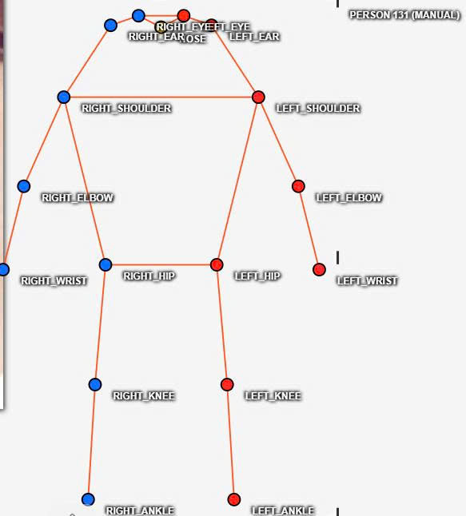
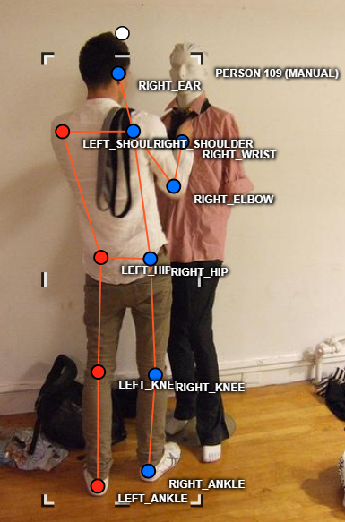
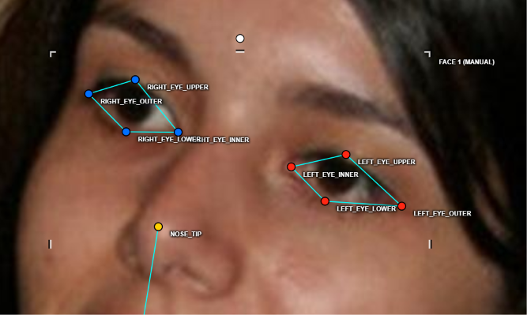
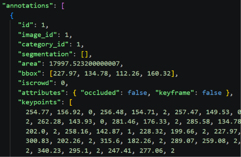

# Báo cáo cá nhân — Nguyễn Thành Đạt (2A202603258)

Đổi tên file theo quy tắc `MSSV_HoTen.md`. Ví dụ: `20241234_NguyenVanAn.md`.

Dữ liệu: 12 ảnh người COCO val2017 (Lin et al., 2014) và 8 ảnh chân dung Wikimedia Commons, chỉ dùng trong lớp.

## 0. Thông tin học viên

- Họ tên: Nguyễn Thành Đạt
- MSSV: 2A202603258
- Email: nguyenthanhdatvn2005@gmail.com
- Link repository: https://github.com/NGUYENTHANHDATHH/K5-L2B-DAY04-NguyenThanhDat-2A202603258-KeypointPose
- Phiên bản CVAT (Help → About): 2.69.0
- Máy: hệ điều hành 32 · RAM 516 GB · chạy CVAT chế độ đầy đủ
- Bộ ảnh (`src/exports/assignment.json` do `lab.py setup` tạo): có
- Giờ bắt đầu: 16:20
- Giờ kết thúc: 18:00

## 1. Kiểm tra label (CP0)

| Label    | Kiểu     | Số điểm | Tên điểm đúng bảng của lab? | Đúng thứ tự? | Số cạnh |
| -------- | -------- | ------: | --------------------------- | ------------ | ------: |
| `person` | skeleton |      17 | yes                         | yes          |      19 |
| `face`   | skeleton |      13 | yes                         | yes          |      13 |

Mẫu `person` dựng theo người quay mặt về camera (các điểm `left_*` nằm bên phải khung mẫu)? Có

Cách đổi cờ `occluded` / `outside` cho **một điểm** trên phiên bản CVAT này (một câu): dùng phím tắn Q/O

...

## 2. Số lượng đã gán và thời gian (CP1, CP2)

| Nhóm ảnh   | Số ảnh | Số skeleton đã gán | Số người dưới 60 px (không gán) | Số poster / gương / màn hình bỏ qua | Thời gian (phút) |
| ---------- | -----: | -----------------: | ------------------------------: | ----------------------------------: | ---------------: |
| `easy`     |      5 |                  5 |                               0 |                                   0 |               30 |
| `occluded` |      3 |                  4 |                               0 |                                   0 |               20 |
| `back`     |      2 |                  3 |                               0 |                                   0 |               20 |
| `small`    |      1 |                  2 |                               3 |                                   0 |               10 |
| `crowd`    |      1 |                  3 |                               0 |                                   0 |               10 |
| `faces`    |      8 |                  8 |                               — |                                   0 |               30 |

- Số ảnh người đã xong ở mốc phút 105: 6 / 10
- Thời gian thực tế (phút): CP1 **30 · CP2 30** · CP3 20
- Ảnh tốn thời gian nhất là ảnh nào, vì sao? ảnh back, vì phải kéo tay point trái phải

...

## 3. Bảng ca khó (CP1, CP2)

Mỗi điểm bạn phân vân một dòng, nhất là phân vân giữa `v = 1` và `v = 0`, hoặc không chắc hướng người.

| Ảnh              | Người / mặt | Điểm      | Cờ đã chọn | Phân vân giữa       | Lý do chọn           |
| ---------------- | ----------- | --------- | ---------: | ------------------- | -------------------- |
| 000000253584.jpg | người       | right_ear |   occluded | occluded và outside | vẫn đoán được 1 phần |
|                  |             |           |            |                     |                      |
|                  |             |           |            |                     |                      |

## 4. Bảng tự review (CP3)

Đi từ ảnh cuối về ảnh đầu. 5 ảnh người (ít nhất 2 ảnh `back` hoặc `crowd`) và 3 ảnh mặt. Ít nhất 8 dòng, kể cả dòng `ok`. Ghi lỗi trước, sửa sau.

Mã lỗi dùng đúng một trong: `lr_swap`, `vis_flag`, `position`, `missing`, `extra`, `ok`.

| Ảnh              | Người / mặt | Điểm       | Mã lỗi   | Ghi chú                                          | Đã sửa? |
| ---------------- | ----------- | ---------- | -------- | ------------------------------------------------ | ------- |
| 000000012552.jpg | người       | right_ear  | vis_flag | điểm khó nhận diện                               | yes     |
| 000000012552.jpg | người       | right_knee | vis_flag | điểm khó nhận diện                               | yes     |
| 000000057978.jpg | người       | left_knee  | vis_flag | điểm khó nhận diện                               | yes     |
| 000000253584.jpg | người       | toàn điểm  | extra    | người quá bé                                     | yes     |
| 000000360811.jpg | người       | right_hip  | position | hông bị che khó đoán                             | no      |
| face_219250.jpg  | mặt         | eyes       | missing  | đeo kính râm                                     | no      |
| face_380639.jpg  | mặt         | eyes       | missing  | mắt đang nhắm hay mở                             | no      |
| face_505385.jpg  | mặt         | eyes       | ok       | mắt nhìn nghiêng nên right_eye trùng với top_eye | no      |

Tổng hợp số lỗi theo mã:

| `lr_swap` | `vis_flag` | `position` | `missing` | `extra` | `ok` |
| --------: | ---------: | ---------: | --------: | ------: | ---: |
|           |            |            |           |         |      |

Điểm còn phân vân giữa `v = 1` và `v = 0` (ghi cả hai lựa chọn và lý do chọn):

ảnh người bị che đầu gối, chọn v=1 vì vẫn đoán được 1 phần, không chọn v=0 vì ảnh đã bị che khuất

## 5. Kiểm file xuất và kết quả tự kiểm (CP4)

Tự kiểm tay trong file JSON:

| File                         | Người / mặt kiểm (ảnh, thứ tự)  | Số phần tử `keypoints` | Điểm `outside` ra `v = 0`, `occluded` ra `v = 1`? | `num_keypoints` khớp? |
| ---------------------------- | ------------------------------- | ---------------------: | ------------------------------------------------- | --------------------- |
| `NguyenThanhDat_persons.zip` | `000000057978.jpg`, người thứ 1 |                     51 | Có                                                | Có                    |
| `NguyenThanhDat_persons.zip` | `000000012552.jpg`, người thứ 1 |                     51 | Có                                                | Có                    |
| `NguyenThanhDat_faces.zip`   | `face_105668.jpg`, mặt thứ 1    |                     39 | Có                                                | Có                    |

Sau khi xuất, CVAT ghi `occluded` thành `v = 1` và `outside` thành `v = 0`. Tọa độ của điểm `outside` trong file là tọa độ cũ.

Hai job đã chuyển sang completed trên CVAT? Có / Không

Dán phần **TÓM TẮT** in ra từ `src/check_submission.py`:

```text
- File person: NguyenThanhDat_persons.zip
  Số ảnh: 12 · số skeleton `person`: 17 · mỗi annotation 51 số
  Skeleton theo ảnh: 000000012552=3, 000000057978=1, 000000069971=2, 000000090646=1, 000000162046=1, 000000205650=1, 000000253584=2, 000000360811=2, 000000390585=1, 000000451084=1, 000000515309=1, 000000516902=1
  Cờ v: v=2 203 (70%) · v=1 19 (7%) · v=0 67 (23%)
  num_keypoints trung bình: 13.1
- File face: NguyenThanhDat_faces.zip
  Số ảnh: 8 · số skeleton `face`: 8 · mỗi annotation 39 số
  Skeleton theo ảnh: face_105668=1, face_125051=1, face_219250=1, face_279764=1, face_288853=1, face_380639=1, face_496353=1, face_505385=1
  Cờ v: v=2 94 (90%) · v=1 0 (0%) · v=0 10 (10%)
  num_keypoints trung bình: 11.8
- Ghi chú: 77 điểm `v = 0` vẫn mang tọa độ cũ (CVAT 2.x xuất như vậy; chuẩn COCO ghi `0, 0`). Không phải lỗi: điểm `v = 0` bị bỏ qua khi huấn luyện và khi chấm.
- Số [LỖI]: 0 · số [CẢNH BÁO]: 2
Kết quả: ĐẠT (đọc lại từng cảnh báo ở trên)
```

Các `[CẢNH BÁO]` còn giữ nguyên và lý do:

- `000000012552.jpg #1`: cặp `ankle` nằm ngược phía so với các cặp còn lại. Có thể là lỗi `lr_swap` ở cặp cổ chân hoặc do chân bắt chéo thật; cần kiểm lại trên ảnh.
- `000000253584.jpg #1`: các điểm chỉ trải cao 41 px, nhỏ hơn ngưỡng 60 px. Đây là người dưới 60 px nhưng đã có skeleton trong file xuất; nên xóa skeleton nếu đúng là người quá nhỏ.

## 6. Ảnh chụp màn hình

1. Label `person` trong label constructor (đủ 17 điểm có tên):

   

2. Một người quay lưng đã gán, cờ đã đặt:

   

3. Một khuôn mặt đã gán 13 điểm, phóng to vùng mắt:

   

4. Một đoạn JSON xuất của một người:

   

Nguồn ảnh: COCO val2017 / Wikimedia Commons.

## 7. Tự đánh giá

1. Lỗi bạn mắc nhiều nhất hôm nay, và cách bạn sẽ tránh ở dự án thật:

   Lỗi dễ mắc nhất là không kiểm tra lại trái/phải ở các điểm chi như cổ chân, đặc biệt khi chân bị bắt chéo hoặc người quay lưng. Ngoài ra, tôi đã gán một người chỉ cao khoảng 41 px dù guideline yêu cầu không gán người dưới 60 px. Ở dự án thật, tôi sẽ kiểm tra hướng trái/phải và kích thước người trước khi lưu từng annotation, sau đó chạy script tự kiểm trước khi bàn giao.

2. Một quy tắc bạn đề xuất thêm vào guideline (kèm ảnh ví dụ nếu có):

   Sau khi gán xong mỗi người, cần thực hiện checklist 10 giây: nhìn đường nối vai–hông–gối–cổ chân, kiểm tra các cặp `left_*` / `right_*` có nhất quán, rồi kiểm tra chiều cao người có từ 60 px trở lên hay không. Nếu một cặp bị ngược phía hoặc người quá nhỏ thì phải sửa hoặc xóa trước khi chuyển sang ảnh tiếp theo.

3. Nhãn của bạn đi vào model ở đâu? Chọn một lỗi bạn đã sửa và nói nó sẽ làm model học sai thế nào (heatmap, trọng số trong loss, hay bước lật ảnh):

   Nhãn đi vào model dưới dạng tọa độ keypoint và cờ visibility. Với lỗi đổi trái/phải ở cặp cổ chân, tọa độ vẫn có thể nằm đúng vị trí vật lý nhưng bị gán sai tên `left_ankle` và `right_ankle`. Khi huấn luyện, heatmap của hai kênh trái/phải bị đảo, làm model học sai vị trí tương ứng; lỗi này còn gây sai khi thực hiện bước lật ảnh vì các cặp trái/phải không còn nhất quán. Điểm bị `outside` có `v = 0` sẽ được bỏ qua, nên không nên kéo điểm ngoài ảnh vào mép ảnh để tạo nhãn giả.

## 8. Khó khăn và lỗi kỹ thuật

no

## Bonus (nếu làm)

### B1 — 3 ảnh người khó thêm

| Ảnh | Số skeleton | Số người dưới 60 px | Ca khó nhất |
| --- | ----------: | ------------------: | ----------- |
|     |             |                     |             |
|     |             |                     |             |
|     |             |                     |             |

Kết quả `src/check_submission.py` cho `HoVaTen_bonus_persons.zip`:

```text
ok
```

### B2 — 5 ảnh khuôn mặt đen trắng / hồng ngoại

Ảnh không màu khó hơn ở điểm nào? Kính râm trên ảnh hồng ngoại có còn là `v = 1` không?

khó nhận biết các khớp, kính râm có ảnh hồng ngoại thì v=2

### B3 — Model so với nhãn của tôi (không tính điểm)

- Demo đã dùng:
- Ảnh đã thử:

1. Model có trả điểm cho khớp bị che, hay khớp ngoài ảnh không? Confidence ở các điểm đó thế nào?

   ...

2. Với người quay lưng, model có đổi trái/phải không?

   ...

3. Bộ điểm của model có giống 17 điểm COCO không?

   ...

## 9. Tài liệu tham khảo và công cụ AI đã dùng

no
